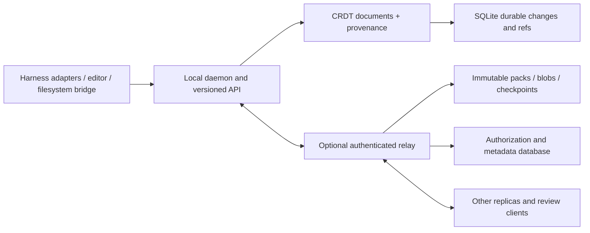

# Architecture and delivery plan

The sections marked “target” are design proposals. Only the local milestone in the README is implemented. This is an independent implementation with a provisional protocol.

## Product contract

The same recorded work should be usable from a terminal harness, an IDE agent, an automated runner or a review client. A harness does not own the durable history. Model inference, credential handling and tool execution remain in the harness unless the user explicitly chooses a runner integration.

Repository, worktree, thread, session, turn, message, tool call, event, actor and file are distinct identities. A thread may eventually reference multiple repositories. Changing providers must not rewrite identities. References to code include stable file identity, text cursors and causal heads; paths and line numbers are display information.

## Current local engine

One room contains file objects, messages, comments and event metadata in one Automerge document. Each file has a stable ID and a path value. Contents use CRDT text; comments use persistent text cursors. Deletion creates a tombstone. Files do not form a directory graph yet.

The filesystem milestone adds observed Git checkout capture and isolated snapshot output. Text remains CRDT text; binary data is currently inline base64. File modes and symlink targets are metadata with visible concurrent alternatives. A per-source observation branch prevents stale disk content from silently replacing primary-branch edits. The bridge does not update source checkouts. See [bridge behavior and limits](bridge.md).

The adapter milestone adds a versioned, schema-validated native event envelope, typed APIs, Codex/Claude stream normalizers and an optional non-interactive CLI supervisor. Normalized events replicate with messages and code; local sequence receipts and process supervision state stay in local SQLite. Harness names in the shared envelope form an open namespace. See [adapter integration and remaining acceptance gap](adapters.md).

An opt-in sharded engine now implements independent file/record CRDTs, structurally shared manifests, atomic global batches, per-document checkpoints and bounded compressed caches. It has a separate v2 bundle format and does not migrate legacy cursors/history. The target section below still includes future work: authenticated selective replication, packed blobs, retention, transcript chunks and larger capacity gates. See [implemented storage design](storage.md).

Each accepted submission is one CRDT change: edits and supplied conversation are committed together. Its hash is the durable change ID. Event metadata links actor, harness and optional session/turn/message/tool IDs. `trace` returns file-level editing events and linked messages; this is not character-level blame. Claims are unsigned, and events do not prove a model's intent. Message ordering is derived from causal changes, not map key order.

SQLite stores change bytes once per room/hash and branch heads in separate refs. Forking adds a ref, not another copy of the stored history. Reconstructing a ref follows causal dependencies. A write transaction checks expected heads, applies operations, stores changes, updates the ref and records the retry receipt atomically. SQLite's writer lock serializes simultaneous local processes. Local sequence numbers only paginate history; they are not distributed time.

An offset request must name the heads the client read. A stale request fails; the client can re-read and re-evaluate, or apply it on its existing offline branch and merge. Silently retrying an offset against different text is unsafe. Full and incremental bundles support offline exchange; missing dependencies abort the transaction. A future online sync protocol must request missing dependencies and bound pending work.

Concurrent text changes converge through Automerge, but valid text can still be invalid code. Concurrent renames/deletion flags and duplicate paths surface as explicit conflicts. There is no automated build/test/merge policy. Even after text convergence, native tools and CI must determine whether a program is correct.

## Target document model and scaling

Avoid a monolithic repository document. Split into a small worktree manifest, per-file text documents, chunked thread documents, and immutable binary blobs. The manifest maps stable file IDs to document identities and tree metadata. Store versions as a manifest frontier plus referenced document frontiers. Changing file shard boundaries is a schema migration, not a configuration tweak.

Partition by workspace/room/document and replicate only documents the client can access. A single hot file remains a hot shard; adding nodes does not remove that limit. Persistent CRDT indices and bounded document caches keep reads independent of the full room history. Cold historical views load checkpoints plus bounded delta tails. Branch refs share immutable change packs; compaction must preserve every retained anchor and historical version or clearly declare a retention boundary.

The implemented [self-hosted relay](relay.md) uses one local SQLite store, room-scoped token grants, durable complete-batch pages and polling clients. The next distributed backend can use PostgreSQL for membership, branch refs, receipts and transactional outbox records, and an S3-compatible store for content-addressed change packs, checkpoints and blobs. Future WebSocket gateways must fan out only after durable commit. Notifications are hints; correctness relies on acknowledged causal changes and resumable sync. PostgreSQL/object storage are proposed, not implemented dependencies.

A versioned batch manifest is needed when a tool call edits several documents: readers must avoid presenting a partially received batch as complete. Choose an explicit visibility barrier or model partial availability. CRDT convergence does not provide cross-document atomicity by itself. Upload immutable objects, confirm durability, then publish the authorized manifest/ref transaction. Acknowledge local persistence separately from remote persistence.

Each stream needs size limits, bounded queues, backpressure, retry budgets and a missing-dependency protocol. ACL checks occur before object fetch and before membership changes become visible. Never make content hashes into bearer capabilities. Authentication identities and CRDT actor IDs are separate. Revocation cannot erase bytes already downloaded by another participant.

## Target filesystem and Git bridge

Import from an explicitly chosen Git root using tracked/untracked listings with NUL delimiters. Respect ignores for untracked files; separately warn or exclude secret patterns because tracked secrets can bypass ignores. No implicit home-directory scan. Preserve binary contents, executable bits, symlinks and Git EOL behavior without treating them as text. Model Git SHA-1 and SHA-256 repositories explicitly.

Observe filesystem changes, compare them with the last acknowledged materialization and generate text edits relative to that version. Watchers can miss intermediate writes and cannot recover unsaved editor buffers; only editor/native harness instrumentation can capture those. Do not claim keystroke granularity from file polling.

Materialization must defend against traversal, symlink escapes, case-insensitive path collisions and overwriting unobserved local changes. Write via temporary files and atomic replacement, with a durable journal and recovery after interruption. Detect our own writes by content/version, not a timing window. Serialize application of remote changes with scanning. Preserve conflict artifacts instead of overwriting dirty files. Never run repository setup scripts automatically as part of importing history.

Git remains a supported boundary: import an existing commit plus dirty state; export selected versions to an isolated checkout; commit with explicit user identity; track which CRDT frontier corresponds to each commit. Git rebases and text object replacement require a defined anchor mapping, with unresolved anchors reported honestly. A commit hash cannot be casually substituted for an Automerge change hash.

## Target adapters

All adapters emit a common envelope with protocol version, source, source event ID, evidence quality, causal basis, thread/session/turn/tool IDs and actor claim. Use native event/hooks interfaces where supported. ACP can map session updates and file tool events; MCP can expose history lookup tools but does not automatically observe a host's entire session. The current JSONL API is neither an ACP nor an MCP server.

Initial adapters should cover one native terminal agent and one different harness, with recorded fixture tests and a live smoke test for each. A generic filesystem bridge is the fallback with `actor: unknown` when attribution is unavailable. Adapter-specific raw events should be opt-in and locally retained for debugging, separate from the stable model. Do not depend on private transcript layouts without explicitly accepting that maintenance burden.

## Milestones and acceptance gates

| Milestone | Deliverable | Gate |
| --- | --- | --- |
| 0 — implemented | Local engine, SQLite changes, JSONL, historical branching, merging, cursors, file-level trace | Automated persistence/concurrency/CLI tests and two-replica demo |
| 1 — implemented, bounded | Git worktree capture, isolated snapshots, polling and recovery journal; no updates to existing checkouts | Linux real-temp-repository tests; ignored files, dirty writes, symlinks, EOL, modes, SIGKILL recovery |
| 2 — implementation available; one live gate pending | Codex/Claude stream adapters, typed contract, JSON Schema, fixture/process/CLI tests | Codex live message/file-edit checks passed; Claude authenticated live session remains unverified |
| 3 — local batched capacity verified; distributed gate incomplete | File/record shards, checkpoints, selective reads, mixed-batch publication, lossless compaction and benchmarks | Local 10k-file profile; 1m edits / 1m CRDT changes in 10k atomic batches across 1k files, including reopen/history/anchor/integrity checks; small ten-replica convergence tests. Relay load, reconnect bandwidth and a million independent commits remain unverified |
| 4 — private single-host relay implemented; distributed backend pending | HTTP relay, room grants, resumable whole-room batch pages, polling clients and consistent backups; file-level selection and object storage remain targets | Ten HTTP clients and three separate CLI clients; two-room ACL boundaries, replay/retry, missing dependencies, restart and backup/restore tests. Multi-host capacity, TLS deployment and hostile-writer resource isolation remain unverified |
| 5 — read-only web review implemented; collaboration editing pending | Named branch snapshots, code diffs/previews, historical conversation and resolved existing comments. Browser comment creation, Git commit export and anchors across Git replacement remain targets | Authenticated HTTP tests and real-browser desktop/mobile checks with synthetic context. Prior native Codex checks remain separate; live browser+agent editing and million-operation UI capacity remain unverified |

Completed local workloads and their measured limits are recorded in [benchmarks](../benchmarks/README.md). The million-edit result covers one local writer with 100 edits per batch and 1,000 retained edits per file; it does not cover a single million-change hot document, a million individual commits or concurrent remote clients. Relay and reconnect gates remain targets. Broader fuzzing across insertion/deletion overlap, duplication and delivery permutations remains necessary; the current suite covers specific convergence and partial-import cases.

## Open-source maintenance

The initial project uses MIT; no public repository or package has been published. Keep a documented contributor workflow, lockfile, security policy, compatibility tests and migration notes. Dependency licenses remain with their owners. If a suitable DeltaDB engine becomes available, re-evaluate reusing it while keeping the public adapter contract independent.
